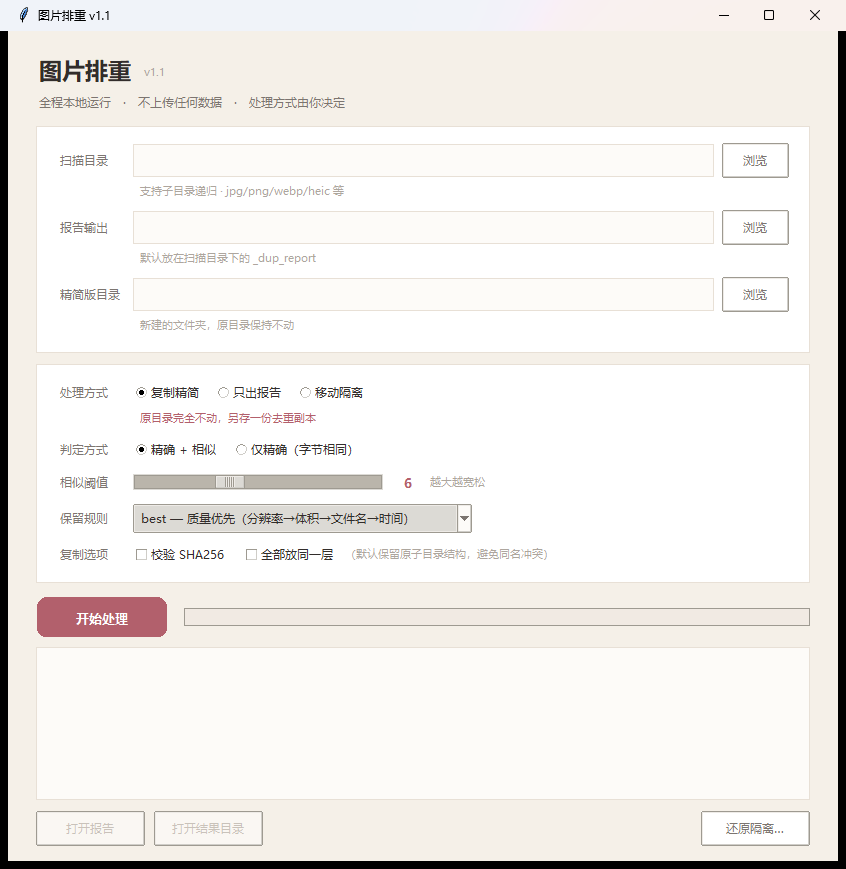

# 图片排重 · DupScan

找出内容相同、但文件名不同的图片，然后按你的意思处理 —— 全程离线，不删除任何文件。

> Find images with identical content but different filenames, entirely offline.
> It reports them, moves them aside, or copies out a deduplicated set — and never
> deletes anything or touches the originals unless you explicitly ask.



## 为什么做这个

批量脚本跑过的图库，经常变成这样：同一张图被复制成 `img17.jpg`、`教学楼1.jpg`、
`教学楼1(1).jpg` 三个名字，肉眼分不出，按文件名去重又完全无效。

现成的去重工具大多要求把图片上传到网页。图片里有身份信息、证件、合同扫描件时，
这条路直接堵死。所以做了这个纯本地版本：单文件 exe，不需要联网，不需要安装 Python。

## 特性

- **两档判定**：SHA256 抓改名的纯副本（零误判），pHash + dHash 抓重新保存/压缩过的同一张图
- **三种处理方式**，都**不删除**任何文件：
  - 复制精简 —— 源目录只读，另存一份去重副本
  - 移动隔离 —— 移到单独目录，一键还原
  - 只出报告 —— 什么都不动
- **可还原**：每次操作落 `manifest.json`，记录完整路径映射，按它原路移回
- **对批量改名友好**：同分辨率同体积时，优先保留 `教学楼1.jpg` 而不是 `img17.jpg`
- **零依赖分发**：PyInstaller 打成单文件 exe，35 MB，拷贝即用
- **报告可读**：CSV 清单 + 并排缩略图 HTML，可点击放大

## 三种处理方式

| 方式 | 源目录 | 产物 |
|---|---|---|
| **复制精简**（默认） | 完全不动，只读取 | 新目录里的去重全集 |
| **移动隔离** | 会减少文件，但可还原 | 隔离目录 + manifest |
| **只出报告** | 完全不动 | 只有报告 |

## 快速开始

### 用打包好的 exe

到 [Releases](../../releases) 下载 `DupScan.exe`，双击运行。

> exe 未签名，Windows SmartScreen 首次会拦截，点「更多信息 → 仍要运行」。
> 部分杀软会误报（PyInstaller 单文件 exe 的常见问题），加白名单即可。

### 从源码运行

```bash
pip install pillow numpy pillow-heif
python src/dupscan/main.py
```

Python 3.9+。HEIC 支持由 `pillow-heif` 提供，不需要的话可以跳过安装，
程序会自动只用 Pillow 支持的格式。

### 命令行

```bash
python src/dupscan/main.py -p "D:\图库" --collect     # 复制精简
python src/dupscan/main.py -p "D:\图库" --isolate      # 移动隔离
python src/dupscan/main.py -p "D:\图库"                # 只出报告
python src/dupscan/main.py --restore "隔离目录\manifest.json"   # 还原
```

完整参数见 [docs/使用说明.md](docs/使用说明.md)。

## 算法要点

```
字节相同  →  SHA256（大小预筛，只对同尺寸的算）
相似      →  pHash ∧ dHash 双指纹汉明距离 ≤ 阈值，且宽高比差异 ≤ 12%
聚类      →  球状贪心聚类（不是并查集）
```

两个设计决定值得单独说：

**为什么不用并查集。** 汉明距离不满足传递性。A≈B、B≈C 但 A≉C 时，并查集会把三张图并成一组，
而且这个链条能无限延伸，最后产出一个巨大的误判组。球状贪心聚类以真实存在的种子图为中心划球，
被吸收的不再当种子，杜绝链式合并。代价是结果对遍历顺序敏感。

**为什么手写 DCT 而不是用 `imagehash`。** 后者依赖 scipy，会让 exe 从 35 MB 涨到 100 MB+，
还多一条依赖链。DCT 变换矩阵只有 32×32，用 numpy 三行就能算出来。

完整推导、复杂度分析、踩过的坑都在 [docs/technical-notes.md](docs/technical-notes.md)。

## 性能

| 规模 | 耗时 |
|---|---|
| 66 张 | 0.7 秒 |
| 266 张（含复制） | 7 秒 |

复杂度 O(n²) 但完全向量化，1000 张的两两比对在 numpy 里不到 1 秒。
**建议规模 5000 张以内**，超出后 `hit` 矩阵和 Python 聚类循环会成为瓶颈。

## 已知限制

- **不处理裁剪和水印**。没有实现 SIFT/ORB 特征点匹配，一张图裁掉 30% 后另存，认不出来。
- **相似阈值需要按数据标定**。默认 6 是经验值，白底图较多的图库建议先跑一次看分布。
- **聚类结果对顺序敏感**。同一批数据在不同机器上跑，分组边界可能略有差异。
- **报告绑定原机器**。缩略图用 `file://` 引用原图，拷到别的电脑看不到图（这是刻意的：
  不在报告里再造一份图像副本）。
- **不支持视频**。

## 构建

```bash
pip install pillow numpy pillow-heif pyinstaller
pyinstaller --onefile --name DupScan --collect-all pillow_heif \
  --exclude-module pandas --exclude-module matplotlib --exclude-module scipy \
  src/dupscan/main.py
```

⚠️ 用于打包的 Python **必须自带 tkinter**（`python -c "import tkinter"` 验证）。
部分精简版 Python 发行版不带，打包时不报错，运行时才炸。

## 目录结构

```
dup-image-finder/
├── src/dupscan/
│   ├── main.py              CLI + tkinter GUI
│   └── app/
│       ├── fingerprint.py   pHash / dHash
│       ├── scanner.py       扫描与聚类
│       ├── isolator.py      移动隔离 / 还原
│       ├── copier.py        复制精简
│       └── reporter.py      CSV / HTML 报告
├── docs/
│   ├── 使用说明.md
│   └── technical-notes.md   实现原理与算法细节
└── scripts/
    └── Find-DupImages.ps1   零依赖兜底方案（Windows PowerShell，仅字节级）
```

## License

[MIT](LICENSE)
